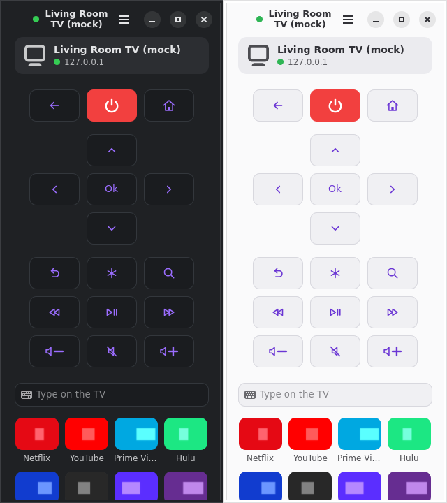
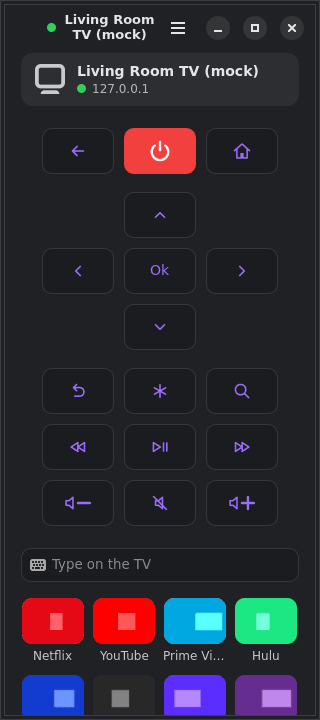

# Remote

A Roku remote for Linux. A small native GNOME app (Rust + GTK4 + libadwaita)
that talks the plain-HTTP Roku ECP API on your LAN. Nothing leaves the
network, no account, no cloud.





> Not affiliated with or endorsed by Roku, Inc. "Roku" is a trademark of
> Roku, Inc. Built with claude co-pilot (like most things these days); I reviewed
> it, made sure the test suite is solid, and did manual testing against my own Roku TV.

Features:

- Layout modelled on [Roam](https://github.com/msdrigg/roam) by Scott Driggers (macOS/iOS;
  none of its code or assets are used): rounded square tiles on one grid
  (Back / Power / Home, a D-pad plus with Ok, then Instant Replay, Options
  (*), Search, Rewind, Play/Pause, Fast-forward, Volume down, Mute, Volume
  up), purple line glyphs, a red Power tile, charcoal in dark mode and
  libadwaita surfaces in light mode. Volume down / up show a large − / +.
- Press-and-hold on the D-pad, volume and seek buttons (sent as
  `keydown` / `keyup`, so the TV auto-repeats like the physical remote).
- A text field that types straight into the focused TV text box as you type
  (`Lit_` keypresses, Backspace, Enter).
- Channel grid built from `/query/apps` (icon tiles with the name below),
  icons cached per device.
- Keyboard control while the window is focused (Ctrl+? lists the keys).
- SSDP discovery (`M-SEARCH roku:ecp`), falling back to a unicast M-SEARCH
  of the local /24 when a host firewall drops replies to the multicast query
  (Fedora's default zone does). The last device is cached and tried first.
- Online / offline dot next to the TV name and on the device card, polled
  every 10 s; long device names wrap instead of being cut off. Several TVs
  on the network: pick one under "TVs" in the header menu.

## Install

### Flatpak bundle (any distro, no root)

Download `remote.flatpak` from the [latest release](https://github.com/NelsonScott/remote/releases/latest), then:

```sh
flatpak install --user remote.flatpak      # pulls the GNOME 50 runtime from Flathub if needed
```

A Flathub listing is submitted; once it is accepted this becomes `flatpak install flathub xyz.scottnelson.Remote`.

### Flatpak from source (no root)

```sh
git clone https://github.com/NelsonScott/remote && cd remote
scripts/install.sh            # builds the Flatpak, installs it for your user
flatpak run xyz.scottnelson.Remote   # or launch "Remote" from the app grid
scripts/install.sh --uninstall
```

`install.sh` needs only `flatpak`. On first run it installs, per user from
Flathub, the GNOME 50 SDK, the Rust SDK extension and `org.flatpak.Builder`
(unless a host `flatpak-builder` exists). The app gets network access (SSDP
and ECP) and the display sockets, nothing else. Its config and icon cache
live in `~/.var/app/xyz.scottnelson.Remote/`.

### RPM from COPR (Fedora)

```sh
sudo dnf copr enable scottnelson/remote
sudo dnf install remote
```

The usual password prompt is dnf's. The RPM links the system GTK4 and
libadwaita, which every GNOME desktop already has; the `-devel` packages are
only ever needed to build from source, never to run.

## Develop

Building from source does not need `gtk4-devel`, `libadwaita-devel` or a
host Rust toolchain: `scripts/dev.sh` runs cargo inside the same GNOME SDK
the Flatpak uses.

```sh
scripts/dev.sh build
scripts/dev.sh test                                # unit + fake-ECP-server tests
scripts/dev.sh clippy --all-targets -- -D warnings
scripts/dev.sh fmt --check
ROKU_MOCK=1 scripts/dev.sh run                     # in-process fake Roku
ROKU_HOST=192.168.1.221 scripts/dev.sh run         # pin a device, skip discovery
RUST_LOG=remote=debug scripts/dev.sh run             # log every command sent
```

Plain host `cargo` works too if you prefer it, after
`sudo dnf install gtk4-devel libadwaita-devel` (Debian/Ubuntu:
`libgtk-4-dev libadwaita-1-dev`).

Headless UI check (Xvfb + xdotool + ImageMagick):

```sh
Xvfb :97 -screen 0 1000x900x24 & export DISPLAY=:97; unset WAYLAND_DISPLAY
GDK_BACKEND=x11 GSK_RENDERER=cairo ROKU_MOCK=1 ROKU_MOCK_LOG=target/reqs.log scripts/dev.sh run &
sleep 6; import -window root target/remote.png; xdotool key h; cat target/reqs.log
```

`ADW_DEBUG_COLOR_SCHEME=prefer-dark` forces dark mode. The SDK sandbox has
its own `/tmp`, so keep logs under `target/`.

After changing dependencies run `scripts/update-cargo-sources.sh` (refreshes
the vendored crate list the offline Flatpak build uses) and commit
`packaging/flatpak/cargo-sources.json` with `Cargo.lock`.

## Packaging

| Path | What |
| --- | --- |
| `packaging/flatpak/xyz.scottnelson.Remote.json` | Flatpak manifest (GNOME 50 runtime, rust-stable extension, offline cargo build) |
| `packaging/flatpak/cargo-sources.json` | generated by `scripts/update-cargo-sources.sh` |
| `packaging/rpm/remote.spec` | RPM spec, vendored crates, `cargo-rpm-macros` |
| `packaging/rpm/make-srpm.sh` | source + vendor tarballs from HEAD, then the SRPM |
| `data/` | desktop file, hicolor PNG app icons + symbolic SVG, AppStream metainfo |

Publish a new RPM: bump `Version` in `Cargo.toml` and the spec, commit, then
`packaging/rpm/make-srpm.sh && copr-cli build remote packaging/rpm/out/*.src.rpm`.

## Environment variables

| Variable | Effect |
| --- | --- |
| `ROKU_HOST` | `ip[:port]` of the Roku. Skips discovery and never writes the config. |
| `ROKU_MOCK` | `1` starts an in-process fake Roku and points the app at it. |
| `ROKU_MOCK_LOG` | File that receives every request the fake Roku saw (one per line). |
| `ROKU_CONFIG_DIR` | Overrides `~/.config/remote`. |
| `ROKU_CACHE_DIR` | Overrides `~/.cache/remote`. |
| `RUST_LOG` | `env_logger` filter, default `remote=info`. |

## Layout

```
src/ecp.rs         ECP client (ureq), key enum, XML parsing
src/discovery.rs   SSDP M-SEARCH (multicast, then unicast /24 sweep), dedupe by USN
src/config.rs      ~/.config/remote/config.toml
src/icons.rs       icon cache
src/fake_roku.rs   fake ECP server (tests + ROKU_MOCK)
src/ui/mod.rs      window, header title, command queue, keyboard, app grid
src/ui/keys.rs     keyboard map + shortcuts dialog rows
src/ui/glyph.rs    cairo line glyphs for the remote tiles
src/bin/fake_roku.rs  `cargo run --bin fake-roku [port]` standalone fake
tests/fake_server.rs  client vs fake server, end to end
data/              .desktop, icons (hicolor PNG set + symbolic), metainfo
packaging/         flatpak/ and rpm/
scripts/           install.sh, dev.sh, update-cargo-sources.sh
docs/PHASE2.md     notes for the next milestone
.github/           CI: fmt, clippy, tests on Fedora; Flatpak bundle; release on tags
```

## License

MIT, see `LICENSE`.
